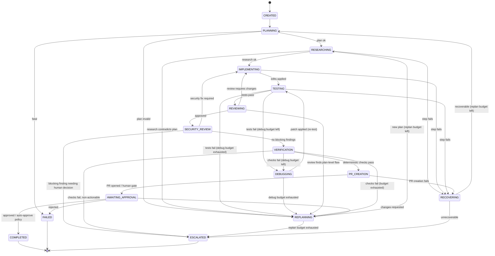

# Agent Pipeline: State Machine + Agents

This document specifies the run lifecycle (state machine) and the nine agents.
It is the contract the orchestrator implements; nothing in this file is
optional behavior.

Related: [architecture.md](architecture.md) · [security.md](security.md) ·
[execution-model.md](execution-model.md)

---

## 1. State machine

### 1.1 States

| State | Meaning |
|---|---|
| `CREATED` | Run registered; workspace not yet prepared. |
| `PLANNING` | Planner decomposes the issue into steps. |
| `RESEARCHING` | Researcher explores the repo relevant to the current step. |
| `IMPLEMENTING` | Developer writes/edits code for the current step. |
| `TESTING` | Tester runs and (if needed) writes tests for the current step. |
| `DEBUGGING` | Debugger diagnoses a failing test run. |
| `REVIEWING` | Reviewer critiques the diff for correctness/quality. |
| `SECURITY_REVIEW` | Security Reviewer checks the diff for vulnerabilities. |
| `VERIFICATION` | Deterministic gate: full test suite + lint + typecheck. |
| `PR_CREATION` | GitHub Agent drafts title/body and opens the PR. |
| `AWAITING_APPROVAL` | Human-in-the-loop checkpoint (e.g., PR opened, or risky action pending). |
| `COMPLETED` | Terminal success. |
| `FAILED` | Terminal failure (unrecoverable or budget exhausted). |
| `RECOVERING` | Compensating actions after a failure (roll back partial edits, re-isolate workspace). |
| `REPLANNING` | Planner revises the plan after repeated failures. |
| `ESCALATED` | Terminal: needs a human; budgets exhausted but run not "wrong". |

### 1.2 Transition diagram

Notes on the diagram:

- Every edge is labeled with the *event* that triggers it. Events come from
  deterministic sources (verification results, budget counters, policy
  decisions, human input) — never from an LLM's claim about what happened.
- `TESTING → REVIEWING` requires the step's tests to pass; it does **not**
  satisfy global verification. Only `VERIFICATION` does.
- Terminal states: `COMPLETED`, `FAILED`, `ESCALATED`.

### 1.3 Transition table (normative)

The implementation is an explicit `dict[tuple[State, Event], State]`. Any
`(state, event)` pair not in the table is rejected — the orchestrator raises
rather than guessing.

| From | Event | To | Guard |
|---|---|---|---|
| `CREATED` | `START` | `PLANNING` | workspace prepared |
| `PLANNING` | `PLAN_OK` | `RESEARCHING` | plan schema-valid |
| `PLANNING` | `PLAN_INVALID` | `REPLANNING` | replan budget left |
| `PLANNING` | `FATAL` | `FAILED` | — |
| `RESEARCHING` | `RESEARCH_OK` | `IMPLEMENTING` | — |
| `RESEARCHING` | `CONTRADICTION` | `REPLANNING` | replan budget left |
| `RESEARCHING` | `STEP_FAILED` | `RECOVERING` | — |
| `IMPLEMENTING` | `EDITS_APPLIED` | `TESTING` | diff non-empty |
| `IMPLEMENTING` | `STEP_FAILED` | `RECOVERING` | — |
| `TESTING` | `TESTS_PASS` | `REVIEWING` | step tests pass |
| `TESTING` | `TESTS_FAIL` | `DEBUGGING` | debug budget left |
| `TESTING` | `TESTS_FAIL` | `REPLANNING` | debug budget exhausted |
| `DEBUGGING` | `PATCH_APPLIED` | `TESTING` | debug attempt counted |
| `DEBUGGING` | `BUDGET_EXHAUSTED` | `REPLANNING` | — |
| `REVIEWING` | `APPROVED` | `SECURITY_REVIEW` | — |
| `REVIEWING` | `CHANGES_REQUIRED` | `IMPLEMENTING` | change count bounded |
| `REVIEWING` | `PLAN_LEVEL_FLAW` | `REPLANNING` | replan budget left |
| `SECURITY_REVIEW` | `CLEAN` | `VERIFICATION` | — |
| `SECURITY_REVIEW` | `FIX_REQUIRED` | `IMPLEMENTING` | — |
| `SECURITY_REVIEW` | `BLOCKING` | `ESCALATED` | — |
| `VERIFICATION` | `CHECKS_PASS` | `PR_CREATION` | — |
| `VERIFICATION` | `CHECKS_FAIL` | `DEBUGGING` | debug budget left |
| `VERIFICATION` | `CHECKS_FAIL` | `REPLANNING` | debug budget exhausted |
| `VERIFICATION` | `CHECKS_FAIL_STUCK` | `ESCALATED` | — |
| `PR_CREATION` | `PR_OPENED` | `AWAITING_APPROVAL` | — |
| `PR_CREATION` | `PR_FAILED` | `RECOVERING` | — |
| `AWAITING_APPROVAL` | `APPROVED` | `COMPLETED` | — |
| `AWAITING_APPROVAL` | `CHANGES_REQUESTED` | `REPLANNING` | replan budget left |
| `AWAITING_APPROVAL` | `REJECTED` | `FAILED` | — |
| `REPLANNING` | `REPLAN_OK` | `RESEARCHING` | replan budget left |
| `REPLANNING` | `BUDGET_EXHAUSTED` | `ESCALATED` | — |
| `RECOVERING` | `RECOVERED` | `PLANNING` | replan budget left |
| `RECOVERING` | `UNRECOVERABLE` | `ESCALATED` | — |

`TESTING → DEBUGGING` and `TESTING → REPLANNING` share the event `TESTS_FAIL`;
the guard (remaining debug budget) selects the edge. The implementation
resolves guards before lookup.

### 1.4 Bounded retries

| Budget | Config key | Default | Counts when |
|---|---|---|---|
| Debug attempts | `retries.max_debug_attempts` | 3 | A `DEBUGGING` entry completes (patch applied or exhausted) |
| Replan attempts | `retries.max_replan_attempts` | 2 | A `REPLANNING` entry completes |

Both are configurable per-run via the YAML config (see architecture.md §6).
Budgets are stored on the `Run` record in SQLite, not in model context — the
LLM is never asked to track or report them, and cannot reset them.

---

## 2. The nine agents

Common contract for all agents:

- **Inputs:** a typed context object (run state, current step, budget
  counters, tool results so far) + untrusted data blobs (issue text, repo
  excerpts, test output) that are clearly delimited and labeled as data.
- **Outputs:** a Pydantic v2 model. Parsing/validation failure = the agent
  produced nothing; the orchestrator retries once, then routes `STEP_FAILED`.
- **Tools:** none execute directly. The agent returns *tool requests*; the
  runtime authority checks the agent's capability grants and executes or
  denies. Default is DENY (see security.md).

### 2.1 Planner

| | |
|---|---|
| **Purpose** | Turn the issue into an ordered, testable plan. |
| **State** | `PLANNING`, `REPLANNING` |
| **Inputs** | Issue text (untrusted), repo overview from Researcher (if any), prior plan + failure summaries on replan. |
| **Allowed tools** | `read_file`, `list_dir`, `grep` (read-only) |
| **Forbidden tools** | `write_file`, `shell`, `git_write`, `github_*` |

**Output schema `Plan`:**

| Field | Type | Constraints |
|---|---|---|
| `summary` | `str` | ≤ 500 chars |
| `assumptions` | `list[str]` | each ≤ 300 chars |
| `steps` | `list[PlanStep]` | ≥ 1 |
| `steps[].id` | `str` | unique, slug-shaped |
| `steps[].description` | `str` | non-empty |
| `steps[].success_criteria` | `str` | must be objectively checkable |
| `steps[].files_likely_touched` | `list[str]` | advisory only |
| `estimated_risk` | `Literal["low","medium","high"]` | `high` forces `AWAITING_APPROVAL` before PR |

### 2.2 Researcher

| | |
|---|---|
| **Purpose** | Locate the code, conventions, and constraints relevant to a plan step. |
| **State** | `RESEARCHING` |
| **Inputs** | Current plan step (trusted, from our `Plan` model), repo (untrusted content). |
| **Allowed tools** | `read_file`, `list_dir`, `grep`, `glob` |
| **Forbidden tools** | `write_file`, `shell`, `git_write`, `github_*` |

**Output schema `ResearchFindings`:**

| Field | Type | Constraints |
|---|---|---|
| `relevant_paths` | `list[str]` | each must exist in workspace (verified) |
| `conventions` | `list[str]` | observed, with evidence path |
| `risks` | `list[str]` | — |
| `recommended_approach` | `str` | non-empty |
| `contradicts_plan` | `bool` | `true` triggers `CONTRADICTION` event |

### 2.3 Developer

| | |
|---|---|
| **Purpose** | Produce the minimal diff implementing a plan step. |
| **State** | `IMPLEMENTING`, and re-entry from `REVIEWING`/`SECURITY_REVIEW` fixes |
| **Inputs** | Plan step, ResearchFindings, prior review comments (trusted models); repo files (untrusted). |
| **Allowed tools** | `read_file`, `list_dir`, `grep`, `glob`, `write_file`, `edit_file`, `shell` (allowlisted commands only), `git_status`, `git_diff` |
| **Forbidden tools** | `git_push`, `git_commit`, `github_*` |

**Output schema `ImplementationResult`:**

| Field | Type | Constraints |
|---|---|---|
| `files_changed` | `list[str]` | must match actual diff (verified) |
| `explanation` | `str` | ≤ 1000 chars |
| `tool_requests` | `list[ToolRequest]` | executed under policy before this result is accepted |
| `step_complete` | `bool` | advisory; tests decide |
| `needs_more_research` | `bool` | routes back to `RESEARCHING` |

### 2.4 Tester

| | |
|---|---|
| **Purpose** | Verify the step's success criteria with runnable tests. |
| **State** | `TESTING` |
| **Inputs** | Plan step success criteria, current diff, existing test suite. |
| **Allowed tools** | `read_file`, `list_dir`, `grep`, `glob`, `write_file` (test files only, path-checked), `edit_file` (test files only), `shell` (test-runner allowlist: `pytest`, `python -m pytest`, etc.) |
| **Forbidden tools** | `shell` (arbitrary), `git_*` writes, `github_*` |

**Output schema `TestReport`:**

| Field | Type | Constraints |
|---|---|---|
| `tests_added` | `list[str]` | — |
| `command_run` | `str` | must be from allowlist (policy-verified) |
| `passed` | `bool` | must match parsed runner output (verified, not model-claimed) |
| `failure_summary` | `str \| None` | required when `passed=false` |
| `suggested_debug_focus` | `str \| None` | passed to Debugger as a hint only |

### 2.5 Debugger

| | |
|---|---|
| **Purpose** | Diagnose failures and produce the smallest corrective patch. |
| **State** | `DEBUGGING` |
| **Inputs** | TestReport, stack traces/test output (untrusted), diff, plan step. |
| **Allowed tools** | `read_file`, `list_dir`, `grep`, `glob`, `write_file`, `edit_file`, `shell` (allowlisted), `git_diff` |
| **Forbidden tools** | `git_commit`, `git_push`, `github_*` |

**Output schema `DebugResult`:**

| Field | Type | Constraints |
|---|---|---|
| `root_cause` | `str` | non-empty |
| `patch_summary` | `str` | non-empty |
| `confidence` | `float` | 0..1; low confidence does not bypass budgets |
| `test_is_wrong` | `bool` | `true` routes a re-write to Tester, never deletes tests silently |

### 2.6 Reviewer

| | |
|---|---|
| **Purpose** | Adversarial review of the cumulative diff for correctness and quality. |
| **State** | `REVIEWING` |
| **Inputs** | Full diff, plan, research findings. |
| **Allowed tools** | `read_file`, `list_dir`, `grep`, `glob`, `git_diff` |
| **Forbidden tools** | All writes, `shell`, `github_*` |

**Output schema `ReviewVerdict`:**

| Field | Type | Constraints |
|---|---|---|
| `verdict` | `Literal["approved","changes_required","plan_level_flaw"]` | maps to events |
| `findings` | `list[ReviewFinding]` | — |
| `findings[].severity` | `Literal["nit","major","blocker"]` | ≥1 `blocker` ⇒ `changes_required` |
| `findings[].file` | `str` | must exist in diff (verified) |
| `findings[].justification` | `str` | non-empty |

### 2.7 Security Reviewer

| | |
|---|---|
| **Purpose** | Check the diff for vulnerabilities and unsafe patterns (injection, secrets, unsafe subprocess, dependency risk). |
| **State** | `SECURITY_REVIEW` |
| **Inputs** | Full diff, relevant file contents. |
| **Allowed tools** | `read_file`, `list_dir`, `grep`, `glob`, `git_diff` |
| **Forbidden tools** | All writes, `shell`, `github_*` |

**Output schema `SecurityVerdict`:**

| Field | Type | Constraints |
|---|---|---|
| `verdict` | `Literal["clean","fix_required","blocking"]` | maps to events |
| `findings` | `list[SecurityFinding]` | — |
| `findings[].cwe` | `str \| None` | e.g. `CWE-78` |
| `findings[].severity` | `Literal["low","medium","high","critical"]` | `critical` ⇒ `blocking` ⇒ `ESCALATED` |
| `findings[].location` | `str` | — |
| `findings[].recommendation` | `str` | actionable |

### 2.8 GitHub Agent

| | |
|---|---|
| **Purpose** | Draft PR title/body from the run history; open the PR. |
| **State** | `PR_CREATION` |
| **Inputs** | Issue metadata, plan summary, final diff, review/security summaries. |
| **Allowed tools** | `github_create_pr`, `read_file`, `git_log`, `git_diff` |
| **Forbidden tools** | `write_file`, `edit_file`, `shell`, `git_push` (push is a runtime-authority action, not a model action) |

**Output schema `PRDraft`:**

| Field | Type | Constraints |
|---|---|---|
| `title` | `str` | ≤ 100 chars |
| `body` | `str` | markdown; must include linked issue ref |
| `branch_name` | `str` | slug-shaped, prefixed `swe-agent/` |
| `draft` | `bool` | risk=high forces `true` |

### 2.9 Verifier

| | |
|---|---|
| **Purpose** | The deterministic-verification *orchestrator-side* agent: it does not use an LLM. It runs and parses the full check suite and emits the event. |
| **State** | `VERIFICATION` |
| **Inputs** | Workspace, check suite from config (tests, lint, typecheck commands). |
| **Allowed tools** | `shell` (check-suite allowlist only), `read_file`, `list_dir` |
| **Forbidden tools** | All writes, `git_*`, `github_*` |

**Output schema `VerificationResult`:**

| Field | Type | Constraints |
|---|---|---|
| `checks` | `list[CheckOutcome]` | — |
| `checks[].name` | `str` | — |
| `checks[].command` | `str` | from allowlist |
| `checks[].exit_code` | `int` | from real process |
| `checks[].passed` | `bool` | `exit_code == 0` |
| `all_passed` | `bool` | derived, not free-form |
| `event` | `Literal["CHECKS_PASS","CHECKS_FAIL","CHECKS_FAIL_STUCK"]` | consumed by transition table |

---

## 3. Agent/orchestrator boundary

- Agents **propose**; they never mutate run state, never pick the next state,
  never count their own retries.
- The orchestrator **dispatches** the agent registered for the current state,
  validates its Pydantic output, executes its approved tool requests via the
  policy engine, runs deterministic checks, and feeds events to the transition
  table.
- The transition table is the only place next-states are computed. Adding a
  transition means editing the table — not the prompt.
